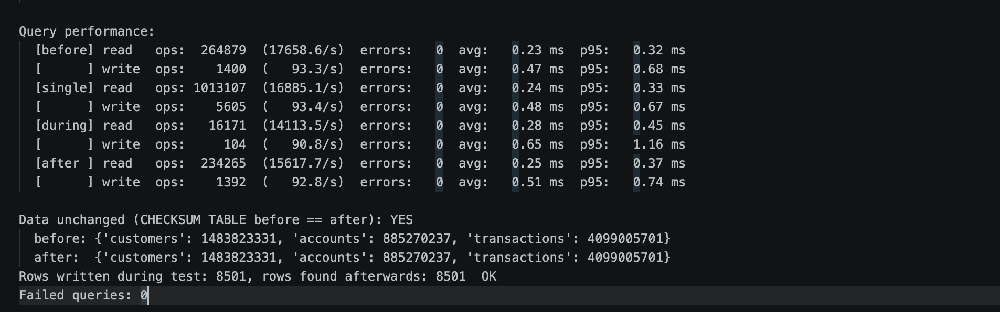
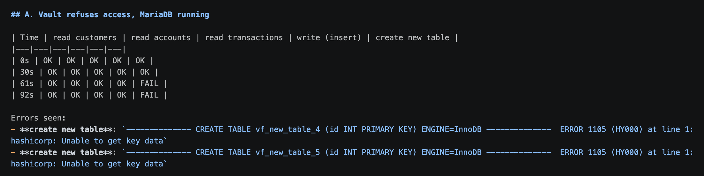
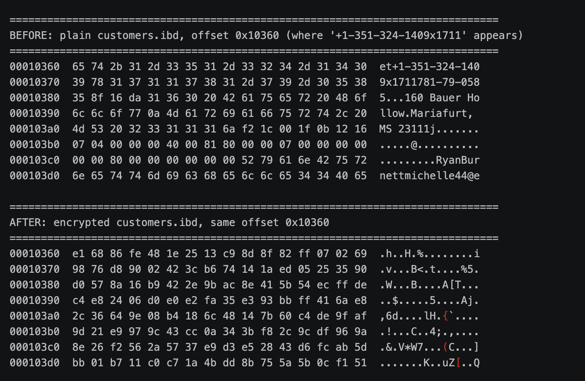

A project for area 10, "Encryption and key management" for the MariaDB student database projects, 2026-09

# MariaDB Encryption and Key Management

This project encrypts the tables of a MariaDB database at rest, with the encryption key stored in HashiCorp Vault. It covers the financial data model (customers, accounts, transactions), the Vault integration, and a key rotation test.

Setup: see [mariadb/README.md](mariadb/README.md) for the database and [vault/README.md](vault/README.md) for Vault.

## Quick start

1. Start the Vault server:

   ```bash
   vault server -config=vault/config.hcl
## Platforms

Tested on macOS (Docker Desktop) and WSL2 Ubuntu with Docker Desktop. Run all commands in a bash-compatible shell. Native Linux is not tested. `start.sh` adds `--add-host=host.docker.internal:host-gateway`, which lets the container reach Vault on Linux.
A complete WSL2 Ubuntu run was verified on November 18, 2026. The workflow successfully built the MariaDB image, loaded 10,000 customers, 50,000 accounts and 1,000,000 transactions, verified the HashiCorp Vault plugin, confirmed that all three tablespaces were encrypted, passed the connection test, and ended with:

```text
Done. MariaDB is running with encryption on.
Each person ran the tests on their own Vault, so the version numbers in each part belong to that person's setup and don't need to match.

## Key Findings

- **Encryption works:** the encrypted table files contain none of the real values, while an unencrypted copy of the same data leaks all of them. The encrypted files had 0 of 114 values readable, against 77 of 77 in the unencrypted copy (Part 4).
- **Rotation under load is safe:** rotating the key while reads and writes were running caused 0 failed queries, and the data checksums were identical before and after (Part 4).
- **One rotation is not enough:** existing data stays on the old key until a second rotation (Part 1 and Part 4).
- **Threads plus a Vault refusal can crash MariaDB:** if Vault refuses access while encryption threads are running, MariaDB crashed (Part 4).
- **Vault outages are survivable, with limits:** cached keys keep reads and writes working while Vault is down, but MariaDB won't start without Vault (Part 4).

## Team and method

**Team:**
- **Zoya:** MariaDB setup, schema, Docker image, rotation under load and the README quick start.
- **Durgesh:** HashiCorp Vault setup, policy, key creation and the connection test.
- **Lilian:** Performance benchmark (Part 3).
- **Aarya:** Security tests: file inspection, key rotation under load and Vault failure scenarios.

**How the work was done:**
- Everything runs in Docker on macOS (Docker Desktop) and WSL2 Ubuntu. The database and Vault are separate from the containers, and MariaDB reads its key from Vault at startup.
- The data is generated with Faker: 10,000 customers, 50,000 accounts and 1,000,000 transactions.
- Rotation was measured with `continuous_writes.py` (Zoya) and `security/key_rotation_test.py` (Aarya), each with reads and writes running.
- Vault failures were simulated without stopping Vault, by denying MariaDB's policy or disconnecting its container from the network (`security/vault_failure_test.py`).

## Part 1: MariaDB Setup (Person 1: Zoya)

The database runs MariaDB 13.0.2 in Docker, with the HashiCorp Vault key management plugin. It holds three tables of financial data:

- `customers`: personal details, including SSN (sensitive)
- `accounts`: account numbers and balances (sensitive)
- `transactions`: amounts, merchants and dates (sensitive, 1,000,000 rows)

### Schema design

The data is synthetic: it's generated by `load_data.py` with Faker, so no real customer data is used.

The database has three tables. Each account belongs to one customer through `accounts.customer_id`, and each transaction belongs to one account through `transactions.account_id`. The most sensitive columns are marked `SENSITIVE` in `schema.sql`: `ssn`, `account_number`, `balance` and `merchant_name`. Encryption is applied per table (`innodb_encrypt_tables=FORCE`), so every column is encrypted on disk, not only the marked ones. The marking shows which data would cause the most harm if it leaked. `transactions` has indexes on `account_id` and `created_at` for lookups by account and by date.

Setup steps are in `mariadb/README.md`. Table encryption is set in `mariadb/hashicorp.cnf` with `innodb_encrypt_tables=FORCE`. The tables were encrypted with `encrypted-config.sql`, and all three report `ENCRYPTION_SCHEME` 1.

The binary log is also encrypted (`log_bin=mysql-bin` and `encrypt_binlog=ON` in `mariadb/hashicorp.cnf`). To check it, we copied the 421 MB binary log out of the container and searched it for a customer email from the table. The email was not found, so the log holds no readable data. The check is `SHOW VARIABLES LIKE 'encrypt_binlog';`, which should return `ON`.

### Key rotation test (Zoya's Vault)

- Key `mariadb/1` was rotated from version 2 to version 3 at 21:05:07 CET, while `continuous_writes.py` was running. Vault records version 3 as created at 21:05:07 CET. The times were recorded manually and are not in `rotation_writes.log`.
- The writes figures are whole-run totals, because the log has no clock time per line. The run that included the rotation completed 1,226,609 writes with 0 errors (2,044 writes per second, average latency 0.49 ms).
- A baseline run with no rotation completed 1,759,961 writes with 0 errors (2,933 writes per second, average latency 0.34 ms).
- In our run, re-encryption of `transactions` finished at about 21:14 CET, roughly 9.5 minutes after the rotation (recorded manually). It needs `innodb_encryption_threads` above 0.
- Aarya's test (`security/rotation_results.txt`) found that one key update was not enough to re-encrypt existing data. Two updates were needed before the tablespaces reported the new current version. The 9.5-minute figure above should be read with that in mind.
- The test rows were removed by rebuilding the database. The current tables were created with key version 3, which matches `CURRENT_KEY_VERSION` 3 and `MIN_KEY_VERSION` 3 in the database now.



## Part 2: Vault Integration (Person 2: Durgesh)

HashiCorp Vault is used as the external key management system for MariaDB data-at-rest encryption.

The MariaDB `hashicorp_key_management` plugin connects to a Vault KV v2 secrets engine mounted at `mariadb/`. The database encryption key is stored under key ID `1` at `mariadb/1`.

MariaDB receives its Vault authentication token through the `VAULT_TOKEN` environment variable. Vault tokens, unseal keys, and encryption key values are not stored in the repository.

The HashiCorp integration was verified successfully. Both MariaDB plugins were active:

```text
hashicorp_key_management        ACTIVE
hashicorp_key_management_cache  ACTIVE
```

MariaDB encryption was configured with:

```text
innodb_encrypt_tables             FORCE
innodb_encrypt_log                ON
innodb_encrypt_temporary_tables   ON
```

The connection test also confirmed that the `customers`, `accounts`, and `transactions` tables are encrypted and accessible.

### Key Rotation

A Vault KV v2 key rotation test was performed.

In Durgesh's recorded rotation test, Vault and MariaDB both reported key version 3 before rotation:

```text
Vault key version:    3
MariaDB key version:  3
```

After rotation, the active Vault key version became `5`.

During this recorded test, MariaDB continued to serve the tested read and write operations without requiring a restart.

The encrypted tablespaces for `accounts`, `customers`, and `transactions` all reported:

```text
CURRENT_KEY_ID       1
CURRENT_KEY_VERSION  5
```

This confirmed successful Vault integration and online key rotation.

Detailed Vault setup instructions, verification commands, and rotation results are available in `vault/README.md`.

## Part 4: Security Testing (Person 4: YOUR NAME)

This part checks whether the setup actually protects the data, and how it behaves during key rotation and when Vault fails. All tests ran on 2026-11-09 against the full data set (10,000 customers, 50,000 accounts, 1,000,000 transactions). The full method, numbers and recommendations are in [security/README.md](security/README.md).

### Findings

| # | Finding | Severity |
|---|---|---|
| 1 | Table files on disk are unreadable without the key: 0 of 114 real values found in the encrypted `.ibd` files, against 77 of 77 in an unencrypted copy. | Confirms encryption works |
| 2 | Key rotation under load: 0 failed queries across reads and writes, identical checksums before and after, and all rows written during the test were saved. | Confirms rotation works |
| 3 | **One rotation does not re-encrypt existing data.** With `innodb_encryption_rotate_key_age = 1`, data stays on the old key until it is more than one version behind. A key that leaked can still read the data until a second rotation. | **High** |
| 4 | **MariaDB crashes if Vault refuses access while background encryption threads are running** (InnoDB assertion, signal 6). These threads are what key rotation turns on. | **High** (availability) |
| 5 | With encryption threads off, MariaDB keeps serving reads and writes while Vault is down. Only operations that need a fresh key (creating a table) fail, and only when Vault actively refuses. | Good resilience |
| 6 | MariaDB refuses to start without Vault ("fails closed"). It recovers in about 2 s with identical data once Vault is back. | Good security behaviour |





### Before and after: the same bytes on disk

The same offset in the `customers` table file, without and with encryption (from `security/before_after.txt`):

```text
Plain:      00010380  35 8f 16 da 31 36 30 20 42 61 75 65 72 20 48 6f  5...160 Bauer Ho
            00010390  6c 6c 6f 77 0a 4d 61 72 69 61 66 75 72 74 2c 20  llow.Mariafurt,

Encrypted:  00010380  d0 57 8a 16 b9 42 2e 9b ac 8e 41 5b 54 ec ff de  .W...B....A[T...
            00010390  c4 e8 24 06 d0 e0 e2 fa 35 e3 93 bb ff 41 6a e8  ..$.....5....Aj.
```

### What this means in practice

- **Rotate twice**, or set up rotation knowing that one rotation leaves existing data on the old key.
- **Check Vault is healthy right before rotating**, and set `innodb_encryption_threads` back to 0 once no table is rotating, to keep the crash window from Finding 4 short.
- **Monitor Vault errors.** A revoked token doesn't break running queries straight away, so it can go unnoticed until the next restart, when MariaDB won't start at all.
- Encryption protects data **at rest** only. Anyone who logs into MariaDB with valid credentials still sees everything in clear text.

### Running the tests

With the project setup running (Vault unsealed, `mariadb` container up, data loaded), from the repo root:

```bash
python3 security/inspect_files.py        # Test 1, needs the plain control container (see security/README.md)
python3 security/key_rotation_test.py    # Test 2, needs the vault CLI logged in
python3 security/vault_failure_test.py   # Test 3, needs the vault CLI logged in
```

Each script writes its results into `security/` and puts the database and Vault back the way it found them, even if it is stopped part-way.
