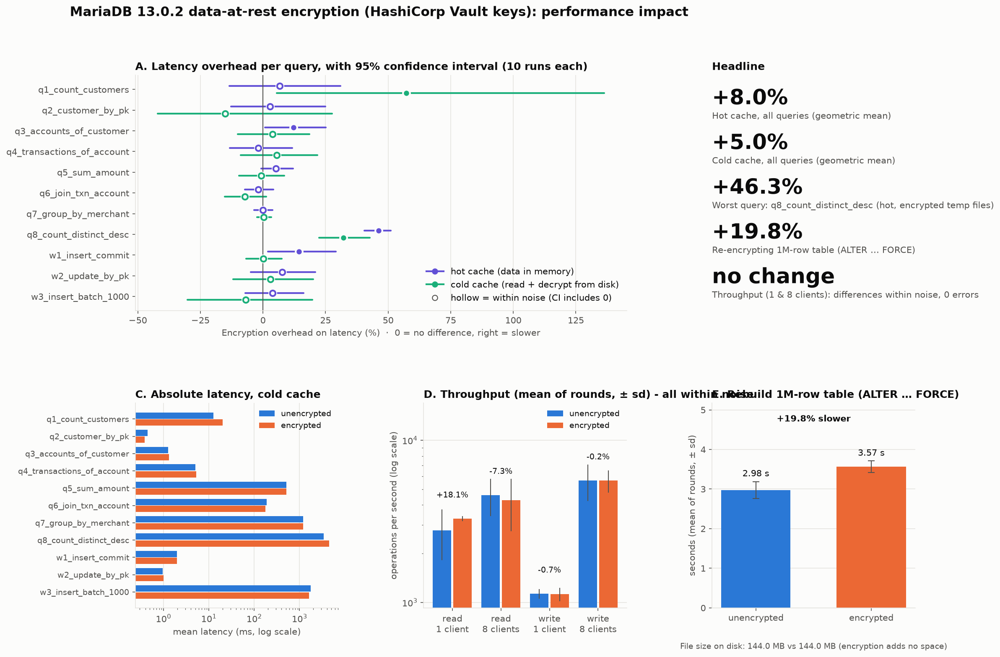

# Performance Analysis: what does encryption cost?

**Person 3: performance.** This compares an unencrypted MariaDB server with the same server encrypted at rest using keys from HashiCorp Vault. Both hold the same 1,060,000 rows (10k customers, 50k accounts, 1M transactions).

**Date of run:** 2026-11-19 · **Raw data:** `results/` · **Chart:** [charts.png](charts.png) · **How to reproduce:** [README.md](README.md)

## Summary

| | Result |
|---|---|
| Everyday queries (lookups, joins, scans, aggregates, single writes) | **+4.8% on average** with data in memory, **+2.6%** from disk. For 8 of the 11 queries the difference is within run-to-run noise. |
| All 11 queries, including the worst one | **+8.0%** hot cache, **+5.0%** cold cache (geometric mean) |
| Worst case: a query that spills to temporary files (`COUNT(DISTINCT …)` over 1M rows) | **+46.3%** hot (2.87 s → 4.20 s), **+32.1%** cold. The only large and consistent cost. |
| Rewriting the whole 1M-row table (`ALTER TABLE … FORCE`, as `encrypted-config.sql` does) | **+19.8%** (2.98 s → 3.57 s) |
| Throughput with 1 and 8 concurrent clients | **No measurable change**, 0 errors |
| Disk space | **No change**: `transactions.ibd` is 144.0 MB on both servers |

**Bottom line:** for the normal workload of this database, encryption at rest costs about **5% or less**, well below the ~50% the project plan assumed. The one place it really costs is **encrypted temporary files**, so the fix there is to stop large queries from spilling to disk, not to turn encryption off.

## Test setup

| | Unencrypted (baseline) | Encrypted |
|---|---|---|
| MariaDB | 13.0.2 | 13.0.2 |
| Encryption settings | none | exactly `mariadb/hashicorp.cnf`: Vault plugin, `innodb_encrypt_tables=FORCE`, `innodb_encrypt_log`, `innodb_encrypt_temporary_tables`, `encrypt_tmp_disk_tables`, `encrypt_tmp_files`, `encrypt_binlog` |
| Key | – | Vault KV v2 `mariadb/1`, key version 1; all 3 tables `ENCRYPTION_SCHEME = 1` |
| Buffer pool | 1 GB (hot) / 32 MB (cold) | same |
| Durability | `innodb_flush_log_at_trx_commit=1`, binary log on | same |
| Data | 10,000 / 50,000 / 1,000,000 rows | identical (`CHECKSUM TABLE` equal on both) |

Machine: Windows 11 laptop, Intel Core i7-1250U (10 cores / 12 threads), 16 GB RAM, NVMe SSD. Both servers ran on the same machine, one benchmark client, over localhost. InnoDB uses unbuffered I/O here (`innodb_flush_method=unbuffered`), so in the cold test pages really come from the SSD, not from a Windows file cache.

Proof that the encrypted server really encrypts: a customer email (`customers` row 42) was found in the unencrypted `customers.ibd` file and **not** in the encrypted one. This matches Part 4's file inspection.

### Method

- **10 measured runs per query** after 1 discarded warm-up run. In each run both servers execute the same query with the **same seeded random ids**, and the server that goes first alternates, so background noise hits both sides equally.
- Each run repeats fast queries many times (e.g. 300 primary-key lookups) and slow 1M-row queries once. The value per run is the mean.
- **Variance** is calculated across the 10 runs: standard deviation, variance, CV and 95% CI per query are in `results/baseline_unencrypted.csv` and `results/encrypted.csv`.
- **Is the difference real?** For each query, `analysis.py` bootstraps the 10 run means of each server (10,000 resamples) into a 95% confidence interval for the overhead. If the interval contains 0%, we call it **noise**: we can't tell the servers apart.
- Writes run with autocommit, so each write's time includes its commit (encrypted redo log and binlog, plus fsync). Benchmark rows are deleted after each run (untimed) to keep both data sets identical.

## Results

### 1. Hot cache (1 GB buffer pool, all data in memory)

| Query | Type | Baseline ms (± sd) | Encrypted ms (± sd) | Overhead | 95% CI | Real? |
|---|---|---:|---:|---:|---:|:---:|
| `q1_count_customers` | small scan | 2.129 ± 0.413 | 2.271 ± 0.683 | +6.7% | -13.4% to +30.9% | noise |
| `q2_customer_by_pk` | point lookup | 0.327 ± 0.036 | 0.336 ± 0.102 | +2.8% | -12.8% to +24.9% | noise |
| `q3_accounts_of_customer` | index lookup | 0.386 ± 0.045 | 0.434 ± 0.061 | +12.3% | +0.9% to +25.1% | yes (borderline) |
| `q4_transactions_of_account` | index lookup | 0.719 ± 0.103 | 0.706 ± 0.114 | -1.8% | -13.3% to +11.6% | noise |
| `q5_sum_amount` | full scan 1M | 213.6 ± 10.3 | 224.6 ± 20.8 | +5.2% | -0.7% to +12.0% | noise |
| `q6_join_txn_account` | join | 7.318 ± 0.582 | 7.177 ± 0.400 | -1.9% | -7.2% to +4.1% | noise |
| `q7_group_by_merchant` | aggregate 1M | 896.5 ± 44.4 | 896.9 ± 36.2 | +0.0% | -3.6% to +3.9% | noise |
| `q8_count_distinct_desc` | temp files 1M | 2,868.1 ± 157.3 | 4,195.1 ± 122.6 | **+46.3%** | +40.4% to +51.0% | **yes** |
| `w1_insert_commit` | write | 0.887 ± 0.090 | 1.015 ± 0.183 | +14.4% | +2.0% to +29.2% | yes |
| `w2_update_by_pk` | write | 0.576 ± 0.074 | 0.621 ± 0.098 | +7.7% | -4.9% to +21.0% | noise |
| `w3_insert_batch_1000` | bulk write | 961.6 ± 151.7 | 998.4 ± 104.4 | +3.8% | -7.0% to +16.2% | noise |
| **All 11 queries** | geometric mean | | | **+8.0%** | | |
| **Without q8** | geometric mean | | | **+4.8%** | | |

### 2. Cold cache (32 MB buffer pool: pages are read from disk and decrypted)

| Query | Type | Baseline ms (± sd) | Encrypted ms (± sd) | Overhead | 95% CI | Real? |
|---|---|---:|---:|---:|---:|:---:|
| `q1_count_customers` | small scan | 12.7 ± 3.0 | 20.0 ± 13.8 | +57.3% | +5.6% to +136.4% | yes (very wide CI) |
| `q2_customer_by_pk` | point lookup | 0.448 ± 0.257 | 0.381 ± 0.129 | -15.0% | -42.1% to +27.6% | noise |
| `q3_accounts_of_customer` | index lookup | 1.274 ± 0.271 | 1.322 ± 0.139 | +3.8% | -10.1% to +18.6% | noise |
| `q4_transactions_of_account` | index lookup | 5.029 ± 0.927 | 5.309 ± 0.847 | +5.6% | -8.9% to +21.8% | noise |
| `q5_sum_amount` | full scan 1M | 510.4 ± 65.1 | 506.6 ± 42.6 | -0.7% | -9.6% to +8.5% | noise |
| `q6_join_txn_account` | join | 188.3 ± 22.4 | 174.8 ± 17.8 | -7.2% | -15.4% to +1.3% | noise |
| `q7_group_by_merchant` | aggregate 1M | 1,201.6 ± 28.2 | 1,205.1 ± 50.9 | +0.3% | -2.4% to +3.3% | noise |
| `q8_count_distinct_desc` | temp files 1M | 3,390.2 ± 387.1 | 4,480.1 ± 285.0 | **+32.1%** | +22.5% to +42.7% | **yes** |
| `w1_insert_commit` | write | 1.965 ± 0.160 | 1.968 ± 0.178 | +0.1% | -6.8% to +7.5% | noise |
| `w2_update_by_pk` | write | 0.967 ± 0.177 | 0.995 ± 0.183 | +2.9% | -11.9% to +20.1% | noise |
| `w3_insert_batch_1000` | bulk write | 1,751.9 ± 722.1 | 1,630.3 ± 389.5 | -6.9% | -30.2% to +19.8% | noise |
| **All 11 queries** | geometric mean | | | **+5.0%** | | |
| **Without q8** | geometric mean | | | **+2.6%** | | |

### 3. Rebuilding the 1M-row table (`ALTER TABLE transactions FORCE`, 3 rounds)

| | Baseline | Encrypted | Overhead | 95% CI |
|---|---:|---:|---:|---:|
| Time | 2.98 ± 0.21 s | 3.57 ± 0.14 s | **+19.8%** | +11.3% to +28.8% |

### 4. Throughput (concurrent clients, 2 rounds of 8 s each)

| Test | Clients | Baseline ops/s | Encrypted ops/s | Change | 95% CI | Errors |
|---|---:|---:|---:|---:|---:|---:|
| primary-key reads | 1 | 2,785 | 3,289 | +18.1% | -7.6% to +60.4% | 0 |
| primary-key reads | 8 | 4,601 | 4,266 | -7.3% | -41.4% to +42.3% | 0 |
| insert + commit | 1 | 1,133 | 1,124 | -0.7% | -11.5% to +11.1% | 0 |
| insert + commit | 8 | 5,651 | 5,640 | -0.2% | -24.7% to +34.8% | 0 |

Every interval includes 0: **no measurable throughput difference**. Write throughput is almost identical (-0.7% and -0.2%). Read throughput moved in both directions between rounds, which is machine noise, not encryption.

### 5. Size on disk

| Table | Baseline | Encrypted |
|---|---:|---:|
| customers | 3.0 MB | 3.0 MB |
| accounts | 7.0 MB | 7.0 MB |
| transactions | 144.0 MB | 144.0 MB |

## Findings

**1. For normal queries, encryption is close to free.** 8 of 11 queries (hot) and 9 of 11 (cold) showed no difference larger than the noise between runs. That includes full scans of the 1M-row table, a join and the `GROUP BY` aggregate. Without the temp-file query, the average overhead is **+4.8% hot and +2.6% cold**.

**2. Why it's so cheap.** InnoDB encrypts and decrypts **whole 16 KB pages, only when a page moves between disk and memory**. When the data is in the buffer pool (hot), queries read already-decrypted pages, so encryption adds nothing per query. Even in the cold test, where a 1M-row scan reads 144 MB from the SSD each time, `q5_sum_amount` changed by -0.7%. AES with the CPU's AES-NI instructions decrypts several GB per second, far faster than the disk delivers pages, so reading the page costs far more than decrypting it.

**3. The real cost: encrypted temporary files (+46%).** `q8_count_distinct_desc` builds a set of 1M distinct strings. That is larger than the in-memory limit (`tmp_table_size` = 16 MB), so MariaDB writes it to a temporary file. We confirmed this: `Created_tmp_files` increases by 1 for this query on both servers. Only the encrypted server encrypts that file (`encrypt_tmp_files=ON`), and that work happens inside the query itself, so the user waits for it: +1.3 s per query. In the cold test the gap is smaller in percentage terms (+32%) because the baseline is also slower.

**4. Writes pay a small price on commit.** A single-row insert with commit costs +14% hot (0.89 → 1.02 ms, about 0.13 ms more), because the redo log and binary log are encrypted before being written. In the cold test the disk wait dominates and the difference disappears (+0.1%). Concurrent write throughput was unchanged (-0.2% with 8 clients).

**5. Encrypting existing data costs about 20% more than rewriting it unencrypted.** Rebuilding the 1M-row table took 3.57 s instead of 2.98 s, about 0.6 s extra for 144 MB, or roughly **4 s per GB**. This is the cost of `mariadb/encrypted-config.sql` and of key-rotation re-encryption (Part 4: the rotation re-encrypted all tables in 1.1 s under load).

**6. No extra disk space.** Encryption works page by page and keeps the page size, so the files are exactly the same size.

## Recommendations

1. **Keep encryption on.** At about 5% for normal work, the protection (Part 4: 0 of 114 values readable on disk) is worth far more than the cost.
2. **Prevent large queries from spilling to disk** rather than turning off `encrypt_tmp_files`. Turning it off would leak data through temporary files. Instead, add indexes for heavy `DISTINCT`/`GROUP BY`/`ORDER BY` queries, or raise `tmp_table_size` / `max_heap_table_size` for reporting sessions. Watch the `Created_tmp_files` and `Created_tmp_disk_tables` counters.
3. **Give the buffer pool enough memory** to hold the working set. With data in memory, pages are only decrypted once.
4. **Plan bulk re-encryption** (first encryption, `ALTER TABLE … FORCE`, key rotation) for quiet periods: budget about 20% more time than an unencrypted rebuild.
5. **Don't expect throughput loss** for this OLTP-style workload. Size servers as you would without encryption, then confirm with this benchmark on the production hardware.

## Limitations (what this test does not show)

- **One machine, laptop hardware, localhost.** Absolute milliseconds will differ on a server; the **relative** overhead is the meaningful result. Both servers and the client shared one CPU.
- **Quick mode.** Slow 1M-row queries ran once per run (10 values each). Fast queries repeated 50–300 times per run. Throughput used 2 rounds of 8 s, so its confidence intervals are wide. The full mode (`--tp-rounds 3 --tp-seconds 15`, no `--max-slow-reps`) would narrow them.
- **Client overhead is included.** Every timing includes the Python client (`pymysql`) and the network round trip, about 0.2–0.3 ms. This is the same on both servers, but it makes small differences on sub-millisecond queries harder to see.
- **Cold `q1_count_customers` (+57%)** is statistically significant but has a very wide interval (+6% to +136%), caused by a few slow encrypted runs (sd 13.8 ms). It should be re-run before drawing a conclusion from it.
- **Windows binaries instead of the team's Docker image.** It is the same MariaDB version (13.0.2), the same Vault plugin and the same settings as `hashicorp.cnf`. Docker was not available on the test machine. `README.md` has the equivalent Docker commands.
- **Vault itself is not on the query path.** The plugin caches the key (`hashicorp-key-management-caching-enabled=ON`), so Vault is contacted at startup and on key changes, not per query. Vault availability is covered in Part 4.
- The background re-encryption threads (`innodb_encryption_threads`) were 0, as in the team configuration. Their cost during rotation is measured in Part 4 (`security/rotation_results.txt`: read throughput 16,885 → 14,114 ops/s while re-encrypting, then back to normal).

## Comparison with the other parts

- **Part 1 (Zoya)** measured 2,933 writes/s without rotation and 2,044 writes/s during a rotation with `continuous_writes.py`. That answers a different question (the cost of **rotation**), not encryption on/off. Our encrypted-vs-unencrypted write throughput was unchanged.
- **Part 4 (security)** showed read latency going from 0.24 ms to 0.28 ms during re-encryption. That fits finding 5: re-encrypting pages costs CPU and I/O only while it is happening.
